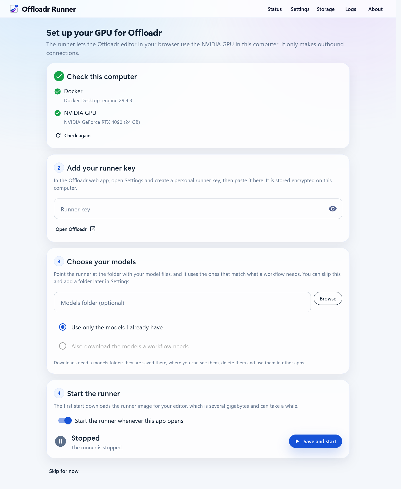
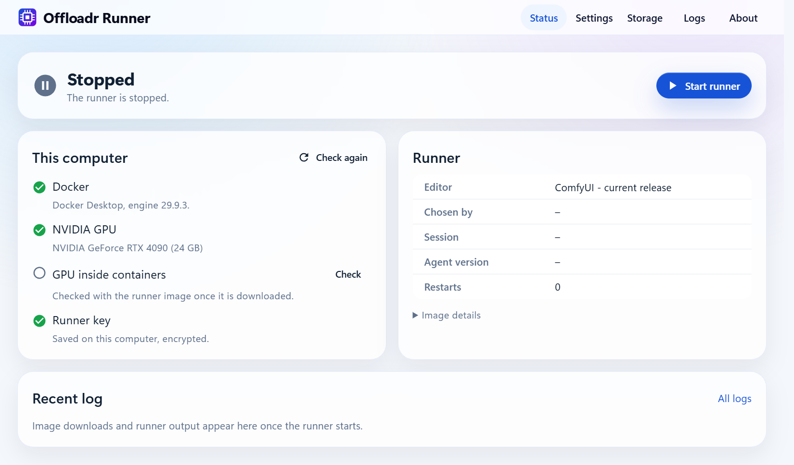

# Offloadr runner

The GPU runner for [Offloadr](https://offloadr.studio). It connects to the Offloadr control plane, runs ComfyUI or Forge Neo sessions on your GPU, and streams the work back to the editor in your browser. It only makes outbound connections.

The runner images Offloadr uses on its own hosted GPUs are built from this repository too.

## What you need

| | Windows | Linux | macOS |
| --- | --- | --- | --- |
| How | The desktop app | Docker (`docker run` or Compose) | Not supported |
| GPU | NVIDIA, with a current driver | NVIDIA, with a current driver | Docker on a Mac cannot give a container a GPU |
| Container engine | Docker Desktop with the WSL 2 backend | Docker Engine with the NVIDIA Container Toolkit | |

You also need a personal runner key, which you create under Settings in the Offloadr web app. AMD and Intel GPUs are not supported.

## Desktop app (Windows 10 and 11)



1. Install [Docker Desktop](https://docs.docker.com/desktop/setup/install/windows-install/) with the WSL 2 backend, and a current [NVIDIA driver](https://www.nvidia.com/en-us/drivers/).
2. Download `OffloadrRunner-Setup.exe` from the [latest release](https://github.com/offloadr/runner/releases/latest) and run it. It installs the app for your Windows account, without administrator rights, and adds it to the Start menu.
3. The first time the app opens, Setup checks Docker and the GPU, with links to fix what is missing. Paste your runner key, choose your models folder and whether the runner may download models, and press Save and start.
4. The first start downloads the runner image for your editor, several gigabytes. Once the runner runs, open your editor in Offloadr; the work runs on this computer.

The app needs the [Microsoft Edge WebView2 Runtime](https://developer.microsoft.com/microsoft-edge/webview2/), which Windows 11 includes; on Windows 10, install it if the app's window stays blank.



What the app does for you:

- **Keeps the runner going.** It picks the runner image for the editor you chose in Offloadr, starts it, restarts it if it stops, and switches to a newer image between sessions. It removes the image a newer one replaced; Storage lists the others and removes the ones you no longer need.
- **Lives in the notification area.** Closing the window leaves it there, where a coloured dot shows the runner's state; quit from the tray icon to stop the runner. Settings can open it there when you sign in to Windows and start the runner with it.
- **Looks after sleep and shutdown.** While a session runs, it keeps the computer awake (the display can still turn off; Settings can turn this off). After sleep it checks the runner, Docker and the GPU again, and when Windows shuts down or you sign out it stops the runner within seconds.
- **Updates itself.** It downloads a new release in the background and installs it when you restart it from the banner, or when you quit it. The runner keeps running through that restart.
- **Helps when something is wrong.** Status says what is wrong and what to do about it. Save diagnostics on the Logs or About page writes a text file for Offloadr support with the app's checks, settings and recent log; it never holds the runner key, and you can read it before you send it.

Your models folder is mounted read-only into the runner. With downloads on, the runner saves the models it downloads there too, where you can see them, delete them and use them in other apps.

To uninstall, use Installed apps in Windows Settings. That removes the app and its runner container. Your settings, runner key and logs stay in `%LOCALAPPDATA%\OffloadrRunner`, and your models folder and Docker's runner images are left as they are; delete them yourself if you no longer want them.

## Docker (Linux, or the command line)

```bash
docker run --rm -it --pull always --gpus all -e RUNNER_SECRET=<your-runner-key> ghcr.io/offloadr/runner-comfyui:latest
```

A runner uses only the models in a folder you give it unless you add `-e RUNNER_MODEL_DOWNLOADS=on`, which lets it download the ones a workflow needs. Models are often several gigabytes each; mount your models folder writable as well and the runner saves them there (see [docs/hosting.md](docs/hosting.md#saving-downloads-in-the-models-folder)). [docs/compose.yaml](docs/compose.yaml) runs the runner with Docker Compose, with a models folder and downloads. Arguments after the image name go to the editor, such as `--use-ck-attention` (see [Editor arguments](docs/hosting.md#editor-arguments)).

| Image | Editor |
| --- | --- |
| `ghcr.io/offloadr/runner-comfyui:latest` | ComfyUI, current release |
| `ghcr.io/offloadr/runner-comfyui:master` | ComfyUI, master branch |
| `ghcr.io/offloadr/runner-forge-neo:latest` | Forge Neo, current release |
| `ghcr.io/offloadr/runner-forge-neo:neo` | Forge Neo, neo branch |

The Linux kernel and container policy must permit `pidfd_open` and `pidfd_send_signal`. The agent checks both during startup and exits before registering or accepting work if they are unavailable or denied.

[docs/hosting.md](docs/hosting.md) covers prerequisites, local model folders, environment variables and troubleshooting.

## Build and test

```bash
dotnet build runner.slnx
```

```bash
docker buildx bake comfyui-latest --load
```

The desktop app needs Windows and the `maui-windows` workload:

```bash
dotnet build runner.desktop.slnx
```

The full test suite needs Linux, root, `gcc` and `aria2c`. From any machine with Docker:

```bash
./build/test-linux.sh
```

[docs/architecture.md](docs/architecture.md) explains how the runner works and how the code is organised. [CHANGELOG.md](CHANGELOG.md) lists what changed in each release.

## Contributing and support

Bug reports are welcome as [issues](https://github.com/offloadr/runner/issues); attach the diagnostics file from the desktop app if you use it. Report security problems privately as described in [SECURITY.md](SECURITY.md). We are not looking for pull requests right now.

## License

[AGPL-3.0-only](LICENSE). Third-party components are listed in [THIRD-PARTY-NOTICES.md](THIRD-PARTY-NOTICES.md).
